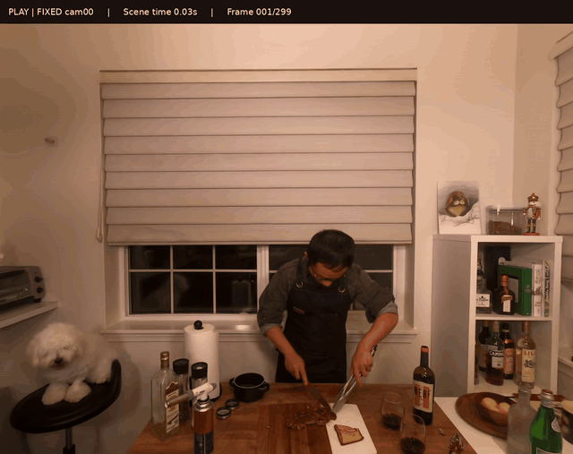

# Shared Appearance Scaffold for Dynamic 3D Gaussian Splatting

English | [简体中文](README_zh-CN.md)

## Overview

Dynamic 3D Gaussian splatting must represent both stable scene appearance and
time-varying detail. Per-Gaussian appearance alone does not explicitly share
repeated evidence across space, while independently optimized motion and
temporal opacity can make motion complexity inconsistent with a primitive's
visible lifetime.

This project adds a multiresolution feature grid as a **shared appearance
scaffold**. Each Gaussian queries the grid at its canonical position and
combines the shared feature with its own local appearance feature. A detached
motion-lifetime coupling scales quadratic and cubic motion by temporal support:
short-lived Gaussians approach linear motion, while long-lived Gaussians keep
the higher-order trajectory. After training, the scaffold contribution is
baked into the Gaussian features, so the compact inference model no longer
needs the grid or its query computation.

The maintained model is `S2.0.4-couptest-poly` with `coupled_detached`
coupling. The repository keeps the legacy `STEGF` environment, configuration,
checkpoint, and log names for compatibility.

## 4D reconstruction example



The demo shows fixed-view playback, camera movement with time paused, and
playback with a moving camera. The 300-frame sequence uses six independent
50-frame models trained for 30,000 steps each with all camera views, solely
for this showcase rather than held-out evaluation. It is a pre-rendered
demonstration, not a real-time viewer; no extra color calibration or blending
between segments is applied.

### Highlights

- Multiresolution spatial features shared at canonical Gaussian positions.
- Per-Gaussian appearance residuals for local and dynamic detail.
- Temporal-support-aware linear, quadratic, and cubic motion.
- All-time sparse initialization with optional frame-0 dense points.
- Scene-configurable ordinary, multiview, and VAD/TAT densification.
- Static-grid baking for smaller and faster compact inference models.
- Integrated preprocessing, training, export, and evaluation for N3D,
  Technicolor, and Google Immersive.

## Installation

Run commands from the repository root. Training requires Conda, an NVIDIA GPU,
and a CUDA compiler compatible with PyTorch 2.0.0 and CUDA 11.8.

```bash
bash script/setup.sh
conda activate STEGF
```

The setup script installs the Python environment and builds the local
rasterization, simple-KNN, and MMCV KNN extensions.

Dataset preprocessing uses a separate environment:

```bash
# Local CUDA 12.8 / Python 3.10 profile
bash script/setup_preprocess.sh

# CUDA 11.8 / Python 3.8 server profile
bash script/setup_preprocess_server.sh

conda activate STEGF-preprocess
```

Both profiles install COLMAP 4.1.1, Open3D, and the image-processing tools.
MiDaS and its weights are installed by default; append `--without-midas` when
the selected configurations do not use MiDaS priors. On a headless server,
install `xvfb` and `xauth`; the preprocessors automatically use `xvfb-run`
when COLMAP needs a display.

## Data preparation

All datasets use one scene-independent processed layout. `<datapath>` defaults
to `/root/autodl-tmp`.

```text
<datapath>/
└── <scene>/
    ├── colmap_0/
    ├── colmap_1/
    ├── ...
    ├── colmap_<duration-1>/
    ├── dense_points.ply                 # optional frame-0 initialization
    └── midas_beit_large_512/            # optional depth-like priors
```

Each `colmap_<time>` contains synchronized images and a COLMAP model under
`sparse/0`. The full time sequence is required. Optional artifacts are needed
only when their corresponding `field_*` options are enabled in the resolved
scene configuration.

| Dataset | Required raw calibration | Preprocessor | Configurations |
| --- | --- | --- | --- |
| N3D / DyNeRF | synchronized `cam*.mp4`, `poses_bounds.npy` | `preprocess_n3d_scene.py` | `configs/n3d_ours` |
| Technicolor | official PNG sequence, `cameras_parameters.txt` | `preprocess_tech_scene.py` | `configs/tech_ours` |
| Google Immersive | calibrated camera MP4s, `models.json` | `preprocess_immersive_scene.py` | `configs/immersive_ours` |

The preprocessors consume existing dataset calibration; they do not estimate
camera poses for arbitrary uncalibrated videos. By default they prepare 50
frames and follow the scene configuration for dense-point and MiDaS generation.
Use `--dense on|off` or `--midas on|off` to override those optional stages.

### N3D / DyNeRF

```bash
conda activate STEGF-preprocess
python script/preprocess_n3d_scene.py \
  --scene coffee_martini \
  --inputpath dataset/DyNeRF \
  --datapath /root/autodl-tmp
```

Supported public scenes are `coffee_martini`, `cook_spinach`,
`cut_roasted_beef`, `flame_salmon_1`, `flame_steak`, and `sear_steak`.
The processed scene also contains `poses_bounds.npy`.

### Technicolor

```bash
conda activate STEGF-preprocess
python script/preprocess_tech_scene.py \
  --scene Fabien \
  --inputpath dataset/Tech \
  --datapath dataset/Tech-pre
```

Supported public scenes are `Birthday`, `Fabien`, `Painter`, `Theater`, and
`Train`. Official sequence offsets are selected automatically by the scene
configuration.

### Google Immersive

```bash
conda activate STEGF-preprocess
python script/preprocess_immersive_scene.py \
  --scene 12_Cave \
  --inputpath dataset/Immersive \
  --datapath dataset/Immersive-pre
```

Supported canonical names are `01_Welder`, `02_Flames`, `04_Truck`,
`09_Alexa`, `10_Alexa`, `11_Alexa`, and `12_Cave`. Immersive scenes retain the
original fisheye supervision frames and one fixed sampling grid per camera:

```text
<datapath>/<scene>/
├── models.json
├── camera_0001/<time>.png
├── camera_0001.npy
├── ...
└── colmap_<time>/
```

The `colmap_<time>/images` files are pinhole images used by COLMAP and the
Gaussian renderer. The `camera_*` frames are the actual fisheye supervision;
the NPY grids map pinhole renders back to that domain.

## Training and evaluation

`script/run_n3d_train_test.py` is the common runner for all three datasets. A
normal run performs four stages:

1. Train the full model.
2. Evaluate the requested full checkpoints.
3. Bake the shared scaffold into a compact inference model.
4. Evaluate the compact final checkpoint.

The compact metrics are the final inference-model results.

### N3D

```bash
python script/run_n3d_train_test.py --scene coffee_martini
```

### Technicolor

```bash
python script/run_n3d_train_test.py \
  --dataset tech \
  --scene Fabien
```

### Google Immersive

```bash
python script/run_n3d_train_test.py \
  --dataset immersive \
  --scene 12_Cave \
  --datapath /root/autodl-tmp/Immersive \
  --savepath /root/autodl-tmp/output/Immersive
```

For custom roots, the runner reads `<datapath>/<scene>/colmap_0` and writes
`<savepath>/<scene>`:

```bash
python script/run_n3d_train_test.py \
  --scene cook_spinach \
  --datapath /data/N3D \
  --savepath /data/output/N3D
```

Run several scenes sequentially with `--scenes`:

```bash
python script/run_n3d_train_test.py \
  --scenes cook_spinach cut_roasted_beef flame_steak
```

Useful validation and reuse modes:

```bash
# Validate paths and print commands only
python script/run_n3d_train_test.py --scene coffee_martini --dry_run

# Short CUDA smoke test
python script/run_n3d_train_test.py \
  --scene coffee_martini \
  --iterations 10 \
  --skip_test_stage \
  --skip_compact_stage

# Export and evaluate an existing full checkpoint
python script/run_n3d_train_test.py \
  --scene coffee_martini \
  --skip_train_stage
```

By default, N3D and Technicolor scenes resolve under `/root/autodl-tmp`, while
another data root can always be supplied explicitly. N3D uses `colmapvalid`,
Technicolor uses `technicolorvalid`, and Immersive uses `immersivevalidss`.

## Compact inference model

Compact export is part of the standard runner. It queries the trained scaffold
at canonical Gaussian positions, bakes the training-camera mean contribution
into the per-Gaussian appearance features, removes training-only grid and
routing parameters, and writes:

```text
<savepath>/<scene>/compact/
```

The original checkpoint is not modified. To export manually:

```bash
python script/export_compact_model.py \
  --quiet --eval \
  --test_iteration 30000 \
  --valloader colmapvalid \
  --configpath configs/n3d_ours/coffee_martini.json \
  --model_path /root/autodl-tmp/output/coffee_martini \
  --source_path /root/autodl-tmp/coffee_martini/colmap_0
```

The exporter verifies representative frames in memory and saves
`compact_config.json` with the compact artifact. Continue training only from
the original full checkpoint.

## 4D trajectory video

The standard evaluation keeps a held-out camera fixed while time advances.
For a qualitative 4D result, `render_4d_video.py` advances time continuously
and moves a virtual camera along a smooth, scene-scaled path derived from the
real calibrated camera rig. Rendering the compact model is recommended:

```bash
python script/render_4d_video.py \
  --quiet --eval \
  --model_path /root/autodl-tmp/output/cut_roasted_beef/compact \
  --source_path /root/autodl-tmp/cut_roasted_beef/colmap_0 \
  --test_iteration 30000 \
  --valloader colmapvalid \
  --frames 150 \
  --fps 30
```

The default output is `<model_path>/trajectory_4d/trajectory_4d.mp4`, together
with a poster frame and a JSON trajectory manifest. `--trajectory_scale`
controls camera motion relative to the calibrated camera spread, and
`--output_scale` changes the video resolution without changing field of view.
The generated path remains inside the calibrated-view neighborhood; it is not
the legacy fixed-radius `colmapmv` helix.

## Repository layout

```text
train.py, test.py                         training and evaluation entry points
helper_train.py, helper_model.py          shared training/model utilities
configs/{n3d,tech,immersive}_ours/        dataset and scene configurations
script/run_n3d_train_test.py              common experiment runner
script/preprocess_*_scene.py              dataset preprocessors
script/export_compact_model.py            compact inference export
script/render_4d_video.py                  moving-view space-time rendering
thirdparty/gaussian_splatting/             model, renderer, and CUDA sources
```

Datasets, checkpoints, and generated outputs are intentionally Git-ignored.

## Acknowledgements

This project is built on the official STGS implementation. Its data pipeline
also follows the STGS preprocessing and Immersive fisheye treatment, the
frame-0 dense reconstruction/downsampling procedure of E-D3DGS, and the
`dpt_beit_large_512` model from MiDaS. Please follow the licenses of the
upstream projects.

```bibtex
@inproceedings{li2024stgs,
  title={Spacetime Gaussian Feature Splatting for Real-Time Dynamic View Synthesis},
  author={Li, Zhan and Chen, Zhang and Li, Zhong and Xu, Yi},
  booktitle={CVPR},
  year={2024}
}
```
