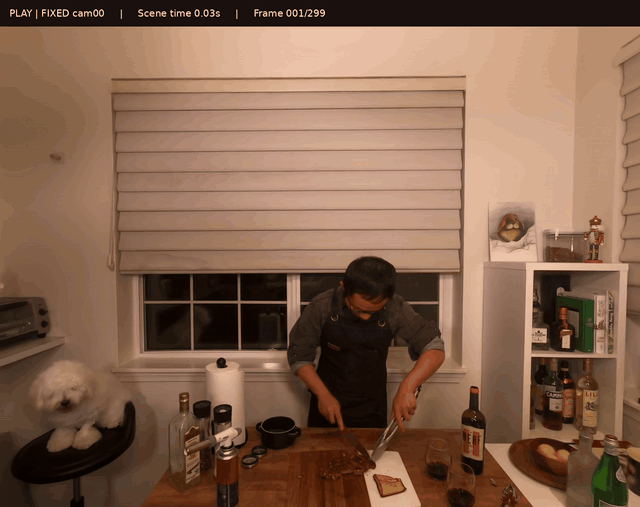
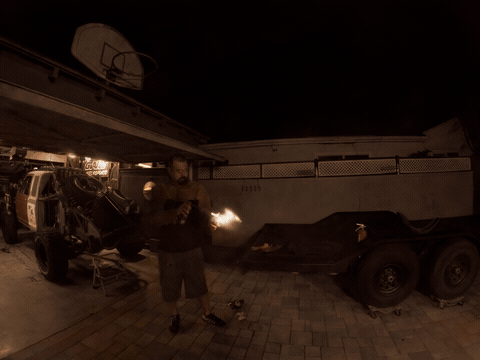

# 面向动态三维高斯溅射的共享外观脚手架

[English](README.md) | 简体中文

## 项目简介

动态三维高斯溅射需要同时表达跨时间稳定的场景外观和随时间变化的动态细节。仅由逐高斯特征承担外观表示时，重复观测中的稳定证据无法通过显式空间结构共享；运动与时间不透明度独立优化时，运动复杂度也可能与高斯的可见时间范围不匹配。

本项目引入多分辨率特征网格作为**共享外观脚手架**。每个高斯在规范位置查询网格特征，并将其与自身的局部外观特征融合。分离梯度的运动—生命周期耦合根据时间支持范围调节二阶和三阶运动：短生命周期高斯趋近线性运动，长生命周期高斯保留高阶轨迹。训练完成后，脚手架贡献可烘焙至逐高斯特征，紧凑推理模型不再需要网格及其查询计算。

## 重建示例

<table>
  <tr>
    <td width="50%"></td>
    <td width="50%"></td>
  </tr>
</table>

## 环境配置

请在仓库根目录执行命令。训练需要 Conda、NVIDIA GPU，以及与
PyTorch 2.0.0 和 CUDA 11.8 兼容的 CUDA 编译器。

```bash
bash script/setup.sh
conda activate STEGF
```

该脚本会安装训练环境，并编译本地光栅化、simple-KNN 和 MMCV KNN 扩展。

数据预处理使用独立环境：

```bash
# 对于RTX50系列显卡： CUDA 12.8 / Python 3.10 配置
bash script/setup_preprocess.sh

# 对于RTX40系列显卡 CUDA 11.8 / Python 3.8 配置
bash script/setup_preprocess_server.sh

conda activate STEGF-preprocess
```

两种配置都会安装 COLMAP 4.1.1、Open3D 和图像处理依赖。默认还会安装
MiDaS 及其权重；如果场景配置不使用 MiDaS 先验，可在环境脚本后添加
`--without-midas`。无显示器服务器需安装 `xvfb` 和 `xauth`；当 COLMAP
需要显示环境时，预处理脚本会自动通过 `xvfb-run` 运行。

## 数据预处理

本工作在Neural 3D 、Technicolor 、Google Immersive三个数据集上进行了验证，三个数据集采用统一的预处理后的场景目录。

```text
<datapath>/
└── <scene>/
    ├── colmap_0/
    ├── colmap_1/
    ├── ...
    ├── colmap_<duration-1>/
    ├── dense_points.ply                 # 可选的下采样后的稠密初始化点云
    └── midas_beit_large_512/            # 可选的深度先验
```

每个 `colmap_<time>` 均包含同步图像和位于 `sparse/0` 的 COLMAP 模型，完整时间序列不可缺少。只有场景配置启用对应 `field_*` 选项时，才需要可选数据。

| 数据集 | 原始数据必须提供的标定 | 预处理脚本 | 配置目录 |
| --- | --- | --- | --- |
| N3D / DyNeRF | 同步的 `cam*.mp4`、`poses_bounds.npy` | `preprocess_n3d_scene.py` | `configs/n3d_ours` |
| Technicolor | 官方 PNG 序列、`cameras_parameters.txt` | `preprocess_tech_scene.py` | `configs/tech_ours` |
| Google Immersive | 已标定的相机 MP4、`models.json` | `preprocess_immersive_scene.py` | `configs/immersive_ours` |

### Neural 3D数据集

从[这里](https://github.com/facebookresearch/Neural_3D_Video.git)下载，然后运行预处理命令

```bash
conda activate STEGF-preprocess
python script/preprocess_n3d_scene.py \
  --scene <scene name> \
  --inputpath <source>/DyNeRF \
  --datapath <pre path>/DyNeRF-pre
```

### Technicolor 数据集

请联系论文《Dataset and Pipeline for Multi-View Light-Field Video》的作者获取 Technicolor 数据集。

```bash
conda activate STEGF-preprocess
python script/preprocess_tech_scene.py \
  --scene <scene name> \
  --inputpath <source>/Tech \
  --datapath <source>/Tech-pre
```

### Google Immersive数据集

从[这里](https://github.com/augmentedperception/deepview_video_dataset)下载

```bash
conda activate STEGF-preprocess
python script/preprocess_immersive_scene.py \
  --scene <scene name> \
  --inputpath <source>/Immersive \
  --datapath <source>/Immersive-pre
```

## 训练与测试

`script/run_n3d_train_test.py` 是三个数据集共用的运行入口。一次标准运行依次完成：

1. 训练完整模型；
2. 测试指定的完整检查点；
3. 将共享脚手架烘焙为紧凑推理模型；
4. 测试最终紧凑检查点。

### N3D数据集

```bash
python script/run_n3d_train_test.py \
  --scene <scene name> \
  --datapath <pre path>/DyNeRF-pre \
  --savepath output/DyNeRF
```

### Technicolor数据集

```bash
python script/run_n3d_train_test.py \
  --dataset tech \
  --scene <scene name> \
  --datapath <pre path>/Tech-pre \
  --savepath output/Tech
```

### Google Immersive数据集

```bash
python script/run_n3d_train_test.py \
  --dataset immersive \
  --scene <scene name> \
  --datapath <pre path>/Immersive-pre \
  --savepath output/Immersive
```

默认情况下，N3D 和 Technicolor 场景从 `/root/autodl-tmp` 解析，也可始终显式指定其他数据根目录。

## 紧凑推理模型

标准运行会自动完成紧凑导出。导出器在高斯规范位置查询训练后的脚手架，将训练相机平均贡献烘焙至逐高斯外观特征，删除仅训练时需要的网格与路由参数，并写入：

```text
<savepath>/<scene>/compact/
```


## 致谢

我们的数据流程参考了 STGS 的预处理与Immersive 鱼眼处理，以及E-D3DGS 的第 0 帧稠密重建与下采样方式，深度先验模型为 MiDaS的dpt_beit_large_512模型。我们衷心感谢这些开源项目的维护者：
[STGS](https://github.com/oppo-us-research/SpacetimeGaussians)
[E-D3DGS](https://github.com/JeongminB/E-D3DGS)
[MiDaS](https://github.com/isl-org/MIDAS)
